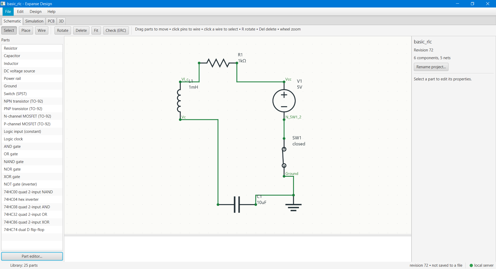
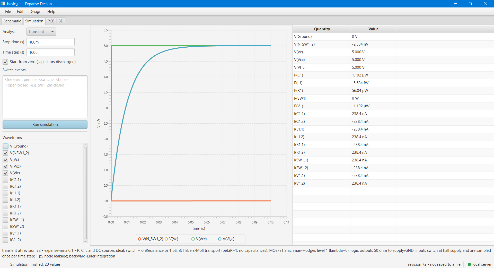
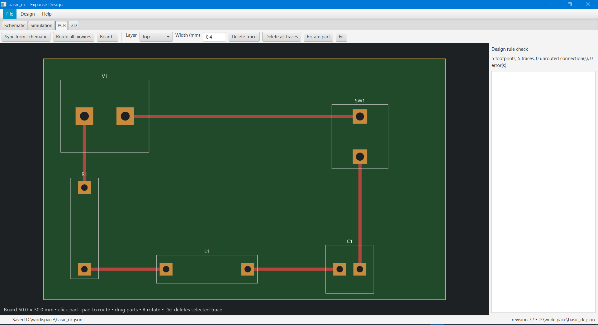
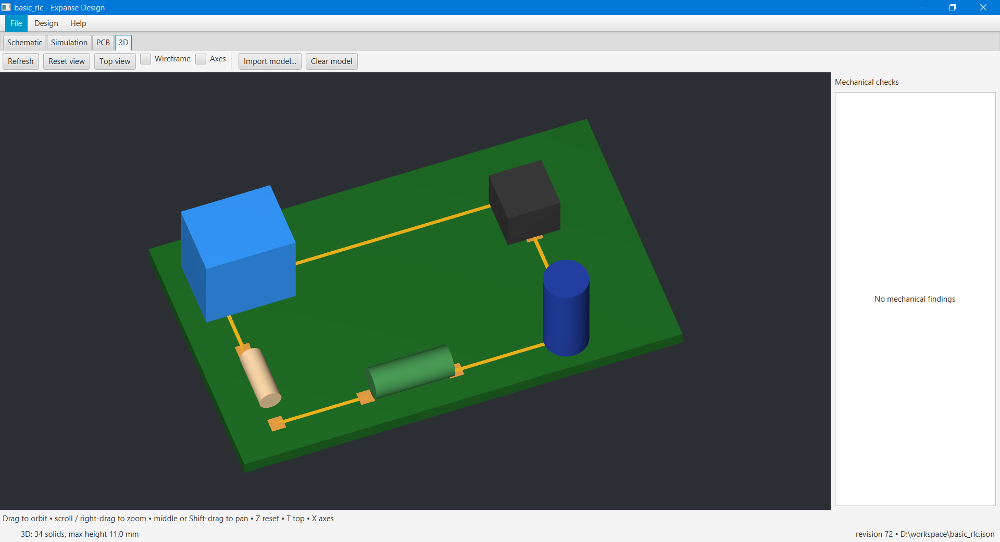

# Expanse Design

A local-first JavaFX EDA workbench with a separate Spring server and an MCP
bridge that lets AI agents inspect and edit designs. The
[product plan](project-plan.md) remains the long-term specification; this is an
early but end-to-end slice.

One switched RLC circuit followed through every view of the workbench:

<table>
  <tr>
    <td width="50%"><a href="img/Schematic.PNG"></a></td>
    <td width="50%"><a href="img/Simulation.PNG"></a></td>
  </tr>
  <tr>
    <td align="center"><b>Schematic</b>: place parts, wire pins, edit values, run ERC</td>
    <td align="center"><b>Simulation</b>: DC operating point, transient and logic analyses</td>
  </tr>
  <tr>
    <td width="50%"><a href="img/PCB.PNG"></a></td>
    <td width="50%"><a href="img/Model3D.PNG"></a></td>
  </tr>
  <tr>
    <td align="center"><b>PCB</b>: sync footprints, route traces, DRC</td>
    <td align="center"><b>3D</b>: assembled board with mechanical checks</td>
  </tr>
</table>

Implemented for **resistors, capacitors, inductors, DC sources, power rails,
ground, SPST switches, diodes, LEDs, op-amps, NPN/PNP BJTs, N/P-channel MOSFETs,
logic gates/sources and sample 74HC ICs (00, 04, 08, 32, 86, 74)** across every layer:

- **Schematic**: palette placement, drag/rotate/delete, drawn wires with bends,
  tees and junction dots (saved in the project), net labels (pins with the same
  label are connected without wires), multi-select (box or Shift/Ctrl-click) with
  group move/rotate/delete, cut/copy/paste/duplicate, net rename/disconnect,
  property editing, electrical rule checks.
- **Part editor**: project-specific parts with pins, parameters, DIP/SIP pad
  generator, courtyard and 3D body; `generic` parts or parts that reuse a
  built-in simulation model. Parts are stored inside the project file.
- **Undo/redo** (Ctrl+Z, Ctrl+Y / Ctrl+Shift+Z) for every edit, from the desktop,
  REST or MCP; each step is a new revision so other clients see it.
- **Simulation**: in-house MNA engine (DC operating point and transient with
  switch events); node voltages, pin currents, power and waveforms. Diodes and
  LEDs use a Shockley model (LED saturation current derived from its forward
  voltage); op-amps have a tanh-limited open-loop gain to their supply rails. Logic parts
  have behavioural analog models, and a separate event-driven four-state
  (0/1/X/Z) logic analysis produces timing diagrams.
- **PCB**: board outline and rules, footprint sync/placement, two-layer
  routing, vias, copper zones (pours) filled around foreign copper with
  clearance, a grid autorouter that uses both layers and vias, ratsnest,
  shorts/clearance/outline DRC.
- **Fabrication**: Gerber RS-274X (copper, mask, silkscreen, outline), Excellon
  drill, BOM and pick-and-place CSV, from the desktop (File > Export fabrication
  files...), REST or MCP.
- **SPICE**: export a netlist (`.op` deck with diode/BJT/MOSFET models, op-amps as
  controlled sources) and import R/C/L/V/D/Q/M netlists as a new laid-out project.
- **3D**: parametric component bodies on the board (orthographic JavaFX 3D view with a camera rig after
  Oracle's sample application), collision/overhang checks, STL/OBJ overlay import.
- **Persistence**: canonical JSON schema 0.5 (0.1-0.4 files migrate on open), H2 file
  or PostgreSQL storage, atomic file save with `.bak`, revision conflict detection.
- **MCP**: 40 policy-gated tools over stdio, including transactional change sets.

All edits from the desktop, REST and MCP go through one transactional change-set
engine: a batch of operations is previewed or applied as a single revision.
Not yet implemented: hierarchy, graphical symbol/footprint drawing, SPICE
transient/AC directives, STEP import.

## Downloads

Every `v*` tag publishes a [GitHub release](../../releases) containing:

| Asset | Use |
| --- | --- |
| `expanse-design-<version>-windows-portable.zip` | Windows, no Java needed: unzip and run `ExpanseDesign\ExpanseDesign.exe`. |
| `expanse-desktop-<version>-<linux\|windows\|macos>.jar` | Client with the embedded local server (Java 21+): `java -jar expanse-desktop-<version>-<os>.jar`. JavaFX natives are per OS. |
| `expanse-server-<version>.jar` | Headless server for shared/remote use; requires `EXPANSE_API_TOKEN`. |
| `expanse-mcp-<version>.jar` | MCP stdio bridge for AI agents (see [MCP](#mcp)). |
| `ghcr.io/talaatharb/expanse-server:<version>` | Docker image of the headless server (linux/amd64, linux/arm64). |
| `SHA256SUMS.txt` | Checksums. |

Run the server image with a persistent volume (it listens on all interfaces
inside the container; put TLS in front of it beyond a trusted network):

```powershell
docker run -d -p 8765:8765 -e EXPANSE_API_TOKEN=<32+ chars> -v expanse-data:/data `
  ghcr.io/talaatharb/expanse-server:<version>
```

Add `-e SPRING_PROFILES_ACTIVE=postgres -e EXPANSE_DB_URL=... -e EXPANSE_DB_USER=...
-e EXPANSE_DB_PASSWORD=...` to use PostgreSQL. Build locally from
[`expanse-server/Dockerfile`](expanse-server/Dockerfile) with a context
directory containing `expanse-server.jar`.

## Build and launch

Requires JDK 21+ and Maven 3.9+ (or the included Maven wrapper).
Run from the repository root in PowerShell:

```powershell
.\mvnw.cmd clean verify
java -jar .\expanse-desktop\target\expanse-desktop-0.1.0-SNAPSHOT.jar
```

By default the desktop starts a separate loopback-only server on port 8765,
waits for authenticated readiness, and stops only the server process it owns when
closed. It reuses an already-running server with matching credentials.
If neither `EXPANSE_API_TOKEN` nor `--expanse.api-token` is set, the desktop
generates a random token once and keeps it in `<data dir>\local-api-token`
(owner-only permissions where supported); copy it from there for MCP or scripts.
The server JAR is located in this order: `--expanse.local-server-jar`, a copy
embedded in the desktop JAR (extracted to `<data dir>\runtime`), then the
development path `expanse-server\target\`. Embed it with:

```powershell
.\mvnw.cmd -Pbundle-local-server -pl expanse-server,expanse-desktop -am package
# Optional: jpackage portable app image + zip (JDK with jpackage required)
.\.github\scripts\package-windows-portable.ps1 -Version 0.1.0-SNAPSHOT `
  -DesktopJar expanse-desktop\target\expanse-desktop-0.1.0-SNAPSHOT.jar -SmokeTest
```

Server startup errors are recorded in `%USERPROFILE%\.expanse-design\server.log`.
Override the data directory with `EXPANSE_DATA_DIR` or desktop
`--expanse.data-dir=...`. Only one server should own an H2 database file.

### Using the desktop

- **File > New / Open file / Open from server / Save / Save as** (Ctrl+N, Ctrl+O,
  Ctrl+S, Ctrl+Shift+S). The server stores every revision immediately; *Save*
  writes the project document to your file atomically and keeps the previous
  file as `.bak`. The title shows `*` while the file is behind the server, and
  closing asks to save. Opening a file whose project already exists on the server
  offers: use the file (replaces the server copy as a new revision), open as a
  copy (fresh IDs), or use the server version.
- **Schematic**: pick a part in the palette and click to place (Shift keeps
  placing). To wire, click a pin (or, with the Wire tool, an existing wire), click
  empty space to add bends (Backspace removes one), and finish on a pin or wire;
  Esc cancels. Click a wire to select it; Del deletes it (pins stay connected).
  With the Label tool (L), click a pin or wire and type a net name: every pin
  labelled with the same name joins that net. Right-click a label to rename or
  delete it.
  Nets without drawn wires are shown auto-routed; pins that a net's wires do not
  reach yet are joined by dashed lines. Drag to move, R rotates, Del deletes,
  wheel zooms; drag empty space to box-select, Shift/Ctrl-click to add or remove
  parts, and middle-drag or Space+drag to pan. R rotates a group around its
  centre. Esc cancels, leaves a tool, then clears the selection. Right-click pins or wires to disconnect or
  rename nets; edit values in the property sheet. *Check (ERC)* lists findings.
- **Part editor** (*Design > Part editor...*, Ctrl+E, or the button under the
  palette): define pins (`number, name[, optional]`), parameters, pads (or
  generate DIP/SIP pads), courtyard and 3D body. Project parts appear at the top
  of the palette; editing a placed part updates its instances.
- **Edit > Undo / Redo** (Ctrl+Z, Ctrl+Y or Ctrl+Shift+Z), **Cut / Copy /
  Paste / Duplicate / Select all** (Ctrl+X, C, V, D, A). Copies keep connections
  and labels between the copied parts and their wires, renumber references and
  bring along project parts; paste lands at the mouse pointer. Free-standing
  labels and wires with two free ends are not copied.
- **File > Settings...** (Ctrl+,): mode (local or remote), server URL, API token
  and data directory, saved to `%USERPROFILE%\.expanse-design\settings.properties`
  (move it with `--expanse.settings-file=...`). *Save and reconnect* switches
  servers in place (restoring the previous connection if the new one fails) and
  reopens the current project file; *Save* applies at the next start.
  Command-line options and environment variables override the file. If the
  desktop cannot connect at startup it offers the settings instead of exiting.
- **Server health**: the dot at the right of the status bar polls the server's
  anonymous `/actuator/health` every 5 s: green UP, amber reachable but not
  healthy, red unreachable. Hover for details; click to open the settings.
- **Simulation**: choose `op`, `transient` or `logic`; values accept SI suffixes
  (`10m`, `2.2u`, `1meg`). Switch events are lines such as `S1 2m closed`.
  Logic shows a timing diagram (X shaded red, Z dashed) and final net levels.
- **PCB**: *Sync from schematic* places footprints; drag parts, R rotates; click a
  pad then a pad on the same net to route on the chosen layer, or *Route all
  airwires*, or *Autoroute* (both layers with vias, keeps clearance). The *Via*
  tool drops a via on the chosen net; the *Zone* tool adds outline corners
  (double-click or Enter finishes) and *Pour board* covers the whole board on the
  chosen net and layer. Select a trace, via or zone and press Del to delete it, or
  *Delete all traces* (traces and vias, confirmed, one revision) to start over.
  *Board...* edits size, thickness and clearance. The DRC list highlights
  offending objects. *File* has *Import/Export SPICE netlist...* and *Export
  fabrication files...* (Gerber, drill, BOM, pick-and-place into a folder).
- **3D**: drag to orbit, scroll/right-drag to zoom, middle or Shift-drag to pan;
  Z resets, T is top view, X toggles axes, W toggles wireframe. *Import model...*
  overlays an STL or OBJ (millimetres, Z up) for visual reference only.

Start with [the all-parts example](fixtures/projects/all-parts.json):
`java -jar .\expanse-desktop\target\expanse-desktop-0.1.0-SNAPSHOT.jar --expanse.open=fixtures\projects\all-parts.json`.
The [logic demo](fixtures/projects/logic-demo.json) has a 74HC74 divide-by-two,
XOR/AND gating and a switch with a pull-up; run a `logic` analysis for 3m with
`SW1 1.2m closed`.
Add `--expanse.desktop.capture-dir=<dir>` to save a PNG of every tab and exit
(useful for visual checks in CI or bug reports). Add
`"--expanse.desktop.capture-simulation=logic;3m;SW1 1.2m closed"` to choose the
captured analysis, stop time and `|`-separated switch events.

To keep a local server running independently of the desktop (the headless
server never generates a token; set the same one for the desktop):

```powershell
$env:EXPANSE_API_TOKEN = [guid]::NewGuid().ToString("N") + [guid]::NewGuid().ToString("N")
java -jar .\expanse-server\target\expanse-server-0.1.0-SNAPSHOT.jar
```

For a remote deployment, configure the same owner token on server and desktop:

```powershell
java -jar .\expanse-desktop\target\expanse-desktop-0.1.0-SNAPSHOT.jar `
  --expanse.mode=remote --expanse.server-url=https://eda.example.com
```

Remote mode never starts a local server or silently falls back to local data.
The same mode, URL and token can be set from **File > Settings...**.
Remote connections require HTTPS. The server binds to loopback by default;
place it behind a TLS reverse proxy for remote access. This initial owner/reader
token model is for a trusted single-owner deployment, not multi-tenant hosting.

## Health and API documentation

The server includes Spring Boot Actuator and springdoc-openapi. These GET
endpoints need no token and expose no project data:

| Path | Content |
| --- | --- |
| `/actuator/health` (and `/liveness`, `/readiness`) | `{"status":"UP"}` only; details are never shown |
| `/actuator/info` | Build and Java version |
| `/v3/api-docs` | OpenAPI 3.1 document for `/api/v1/**`: bearer security scheme and the `op` discriminator mapping of change-set operations |
| `/swagger-ui.html` | Swagger UI; *Authorize* with the owner or reader token to try calls |

Every other actuator endpoint is denied. To hide the documentation on a deployed
server, set `SPRINGDOC_API_DOCS_ENABLED=false` and
`SPRINGDOC_SWAGGER_UI_ENABLED=false`. Use `/actuator/health/readiness` for
container or load-balancer probes.

## PostgreSQL

H2 file storage is the default. Start the server with the PostgreSQL profile:

```powershell
$env:SPRING_PROFILES_ACTIVE = "postgres"
$env:EXPANSE_DB_URL = "jdbc:postgresql://localhost:5432/expanse"
$env:EXPANSE_DB_USER = "expanse"
$env:EXPANSE_DB_PASSWORD = "<database-password>"
java -jar .\expanse-server\target\expanse-server-0.1.0-SNAPSHOT.jar
```

Flyway applies the same versioned relational migration to both databases.
Changing databases does not migrate existing project data; use JSON export/import.

## MCP

The MCP bridge is a **separate, non-web process** connecting to the same REST
server as the desktop. Keep the desktop or standalone server running. Give the
bridge the owner token to let an agent edit, or configure a separate reader
token on the server with `EXPANSE_READ_TOKEN` and give the bridge that token for
inspection only (mutations are then rejected by the server with 403).

Example MCP client entry (replace the path and token):

```json
{
  "mcpServers": {
    "expanse-design": {
      "command": "java",
      "args": ["-jar", "D:\\workspace\\expanse-design\\expanse-mcp\\target\\expanse-mcp-0.1.0-SNAPSHOT.jar"],
      "env": {
        "EXPANSE_API_TOKEN": "<token-at-least-32-characters>",
        "EXPANSE_SERVER_URL": "http://127.0.0.1:8765"
      }
    }
  }
}
```

When the desktop generated the token, use the contents of
`%USERPROFILE%\.expanse-design\local-api-token`.
`EXPANSE_SERVER_URL` works for both client launchers through Spring relaxed
binding. Tokens must contain at least 32 URL-safe characters. MCP stdout contains
only protocol messages; logs go to stderr.

The bridge exposes 20 read-only tools (projects, components, nets, library,
project parts, diagnostics, simulation, PCB board/analysis, 3D scene/checks,
undo history, change preview, fabrication and SPICE export), 18 editing tools
(`project.create`, `project.apply_changes`, placement, wiring, drawn wires, net
labels, part definitions, properties, board sync/placement/routing, vias, zones,
autorouting, SPICE import, undo/redo) and 2 destructive tools. Policy
switches: `--expanse.mcp.allow-mutations=false` exposes only read tools;
`--expanse.mcp.allow-destructive=true` additionally exposes deletes and lets
`project.apply_changes` run destructive operations. Every tool carries MCP
read-only/destructive/idempotent hints. See [MCP and security](docs/architecture/mcp.md).

## Development

- [Architecture and decisions](docs/architecture/overview.md)
- [Implementation roadmap and acceptance coverage](docs/implementation-roadmap.md)
- [Project schema 0.5](schemas/project/0.5.schema.json),
  [all-parts fixture](fixtures/projects/all-parts.json), and the
  legacy [0.1](fixtures/projects/legacy/resistor-loop-0.1.json) and
  [0.2](fixtures/projects/legacy/logic-demo-0.2.json) fixtures used for migration tests

The REST API is strict: unknown JSON properties are rejected and every record
field must be present (send `null` for optional values). The Feign connector
always does this.

`verify` runs the headless domain, simulation, PCB, assembly, JSON/schema and
migration, persistence, REST/Feign, concurrency, file-save, desktop session and
model-import, local-runtime (token/embedded server), and stdio MCP contracts,
plus automated desktop GUI journeys (TestFX, headless Monocle) that start the
real local server and build, simulate, save and reopen a circuit, undo/redo,
connect pins by net labels, and box-select/move/copy/paste/delete a group. Watch
them run on screen with:

```powershell
.\mvnw.cmd -pl expanse-server,expanse-desktop -am verify "-Dtest=WorkbenchGuiTest" "-Dsurefire.failIfNoSpecifiedTests=false" "-Dexpanse.ui-tests.headless=false"
```

The GUI tests are skipped when the server jar has not been built. PostgreSQL integration is opt-in locally and enabled in Linux/Java 21 CI
(requires Docker):

```powershell
.\mvnw.cmd verify "-Dexpanse.postgres.tests=true"
```

### CI and releases

- [`build.yml`](.github/workflows/build.yml) (push to `main`/`master`, pull
  requests, manual): `verify` on Windows/Linux × Java 21/25, then builds the
  bundled desktop and the Windows portable zip, launches it headlessly in capture
  mode as a smoke test and uploads snapshot packages (7-day retention); also
  builds the server Docker image and smoke-tests it (no push).
- [`release.yml`](.github/workflows/release.yml) (tag `v*`, e.g.
  `git tag v0.2.0 && git push origin v0.2.0`): stamps the tag version into all
  POMs, runs the full verify, builds the headless server and MCP JARs once, the
  client + local-server JAR on Linux/Windows/macOS, the Windows portable zip,
  builds the server Docker image from the verified jar, smoke-tests it and pushes
  it to GHCR (multi-arch), then publishes all assets with checksums. Tags
  containing `-` (e.g. `v0.2.0-rc1`) are marked as pre-releases and don't move
  the `<major>.<minor>` image tag.
- Every Maven invocation in CI runs a lifecycle phase (`verify`/`package`) in the
  same run as goals that need sibling modules, such as `dependency:list`, because
  the project's own artifacts are never installed to a repository.

Packaged desktop JARs are OS-specific because they include JavaFX natives; do not
copy a Windows desktop JAR to Linux. Signed native installers and automated GUI
acceptance coverage remain future work.
